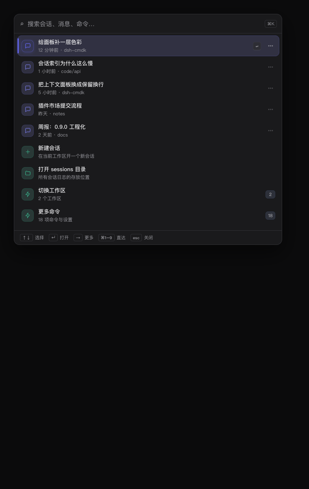
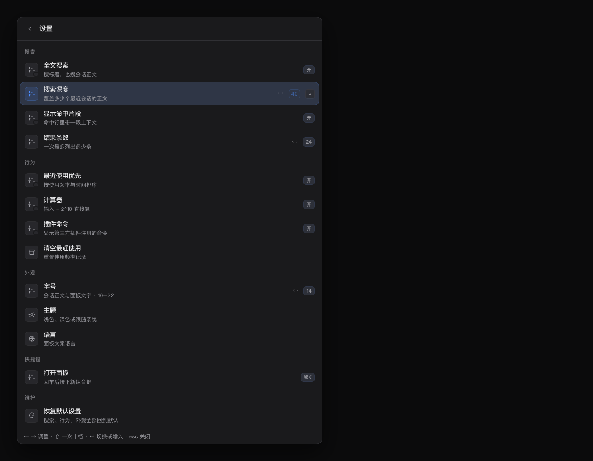
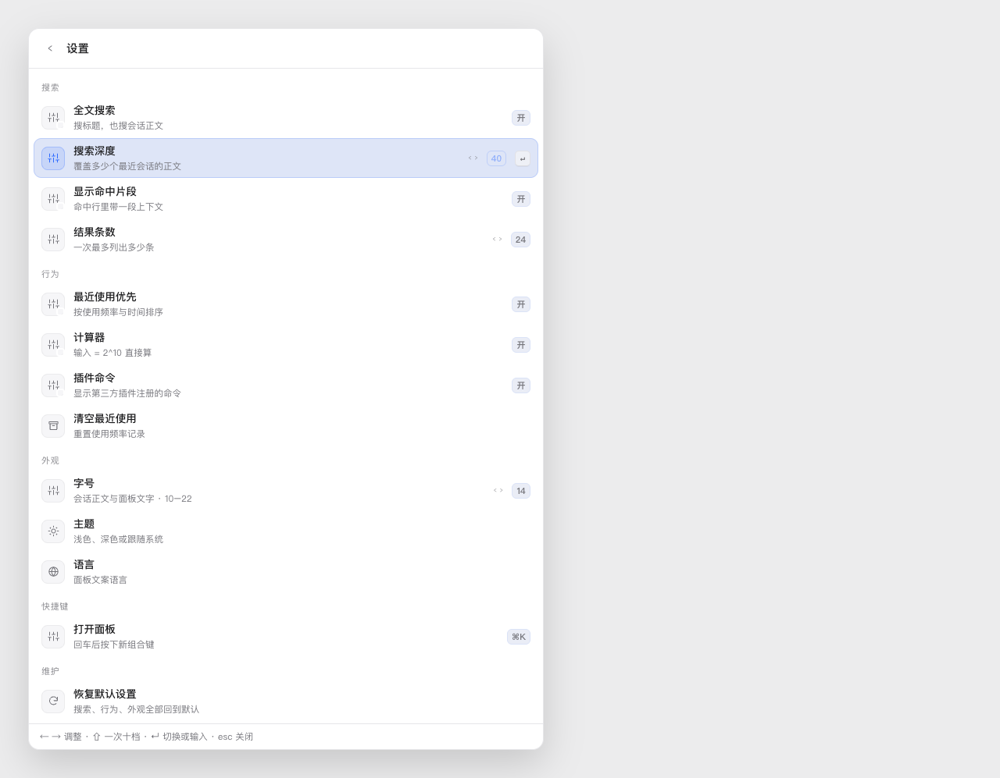
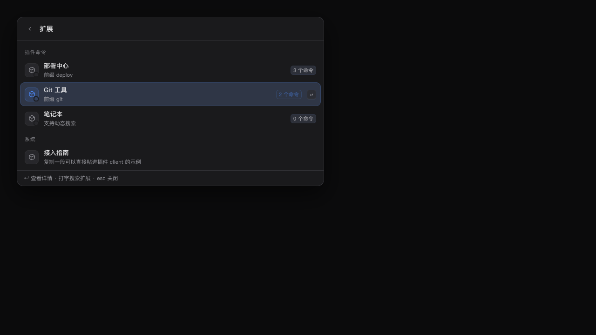
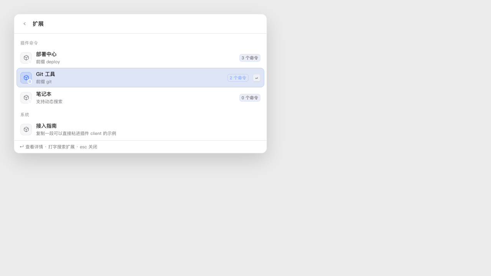
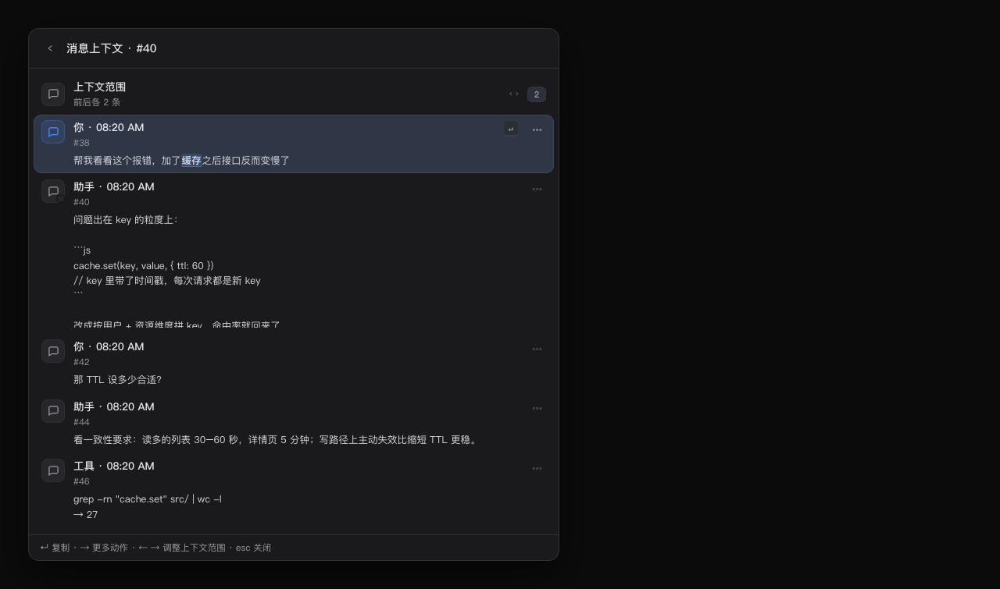

# dsh-cmdk — ⌘K 命令面板

[](https://github.com/hseons/dsh-cmdk/actions/workflows/ci.yml)
[](https://www.npmjs.com/package/dsh-cmdk)
[](LICENSE)
[](package.json)

会话 / 工作区 / 插件 / 动作 / 外观一个入口，正文搜索能定位到具体那条消息，插件可扩展。当前版本见 `package.json` 或面板里的 `?` 帮助页。

一个快捷键跳到任何东西：会话、工作区、常用动作，还能对选中的会话直接做事。
装完即用，零依赖。


## 能做什么

**打开**

| 输入 | 结果 |
| --- | --- |
| `⌘K` / `Ctrl+K` | 打开 / 关闭面板（默认键，可在设置里改；侧栏底部也有同款按钮） |
| 输入会话标题 | 浏览器内即时模糊匹配全部会话（前缀 > 子串 > 拼音首字母 > 子序列），回车直达 |
| 输入中文首字母 | `cj` → 「插件…」，`cjgc` → 「插件广场」 |
| 输入消息内容 | 全文检索命中后带片段补进来，并标出是**第几条消息**；`→` 可看这条消息的上下文 |
| 输入工作区名 | 直接切换工作区 |
| `/` 开头 | 搜文件：最近文件、根目录浏览、递归路径匹配；`↵` 把 `@相对路径` 插进草稿 |
| `深色` / `浅色` / `跟随系统` | 换主题 |
| `中文` / `English` | 换界面语言 |

**首屏是怎么排的**

面板一天要开几十次，所以空查询时只放「你现在要去的」：

1. 最近用过的（最多 8 条，按使用频率乘时间衰减）
2. 全部会话（每行右侧是相对时间 + 工作目录，像 `12 分钟前 · code/api`）
3. 新建会话 / 会话列表
4. 切换工作区（进去才是具体工作区列表）
5. 更多命令 —— 设置、主题、语言、插件命令全收在这一行里

只要开始打字，就回到全量搜索：这些被折叠的项照样参与匹配。
`?` 里的「使用统计」会按真实使用次数排出你最常用的 12 项（只读本机，不上传）。

**外观**

- **一组一色**：会话靛、工作区蓝、命令绿、主题粉、系统灰、扩展橙，设置里的五个分区也各有其色。颜色用 `color-mix` 从当前主题的品牌色和文字色算出来，深浅两种主题下都不用另配一套。
- **选中行一眼可辨**：左侧 2.5px 竖条 + 同色淡底 + 一圈内描边，竖条带同色光晕。长列表里视线不用找。
- **结果入场**：面板 180ms 缩放淡入；结果行按 11ms 递增淡入，只对前 11 行生效，几百行也不会拖着看。
- **滚动边缘渐隐**：只有真的还能往上/往下滚的那一侧才渐隐，到顶到底自动消失。
- **分组标题吸顶**：半透明 + 10px 模糊，右侧是计数的胶囊，滚动时层次不塌。
- **模式色块**：输入 `>` `@` `#` `/` `=` `?` 时，输入框左侧的放大镜换成同色的前缀块，当前在搜什么不用回想。
- **尊重系统设置**：`prefers-reduced-motion` 打开时，入场、逐行淡入、 shimmer 全部关掉。




**模式前缀**（首字符决定搜什么，剩下的照常输入）

| 前缀 | 只搜 | 例 |
| --- | --- | --- |
| `>` | 命令与插件 | `> fork` |
| `@` | 会话 | `@ 登录` |
| `#` | 工作区 | `# dsh` |
| `/` | 文件与路径（工作区文件树、最近文件） | `/ api`、`/src/app.js` |
| `=` | 计算器 | `= (128*9)/3` |
| `?` | 帮助：键位、模式、已接入的 provider、使用统计 | `?` |
| `> 设置` / `> 扩展` | 图形化配置 / provider 管理 | `> 扩展` |

`=` 的结果回车即复制到剪贴板；`?` 里能看到每个 provider 贡献了多少命令。

**`/` 文件模式**

- 空查询先列**根目录第一层**（文件夹在前）+ 最近用过的文件；输入关键字后由 Host
  递归索引整棵树，按「文件名精确 > 前缀 > 包含 > 路径包含 > 首字母子序列」排序，子序列要求字母紧凑，
  `capi` 能找到 `GameKKCAPI`，不会把所有字母凑巧齐全的长文件名都算进来。
- 文件行 `↵` 把 `@相对路径 ` 追加到当前草稿（属于哪个工作区就落到哪个工作区），
  `→` 还有复制绝对/相对路径、在访达中显示并选中、打开所在文件夹。
- 文件夹行 `↵` 直接进去，根目录第一行可当场切换（`pickDirectory`），路径记在
  `localStorage` 的 `dsh-cmdk/file-root`，下次打开还是这里。
- Host 侧有硬上限：深度 6（可调到 12）、15000 个文件、400ms、单目录 2000 项，
  跳过 `node_modules` / `.git` / `dist` 等目录；超出会在底部标「结果已截断」。
  根目录失联（改名、拔盘）时自动丢掉记忆并让 Host 重新选一个。

**对一条会话按 `→`（或行尾的 `…`）可以**

打开 / 重命名 / Fork 到新会话 / 归档 / 复制会话 ID / 复制工作目录路径 /
在访达打开工作目录 / 导出为 Markdown（含图片轮与工具调用，落到下载目录）。

**正文命中的会话还多出四个动作**

- **从这条消息 Fork** — 用命中那条消息的 `seq` 直接分叉，不用再从会话开头翻
- **复制片段** — 把上下文片段复制走
- **就此追问** — 新建会话，把片段作为引用预填进输入框
- **查看上下文** — 取命中前后各 2 条消息，逐个可复制

**插件**

面板里有一组「插件」：列出当前 profile 里所有已安装的插件，显示版本与启用状态；
回车切换启用 / 禁用（走 `pluginManager.setBundleEnabled`，失败自动回滚），
按 `→` 还能直接打开该插件在 `node_modules` 里的目录。

**对工作区按 `→` 可以**

切换、在此新建会话、在访达打开。

**系统**

打开 profile 目录、打开 sessions 目录、打开日志目录、刷新页面、
字号放大 / 缩小 / 重置、搜索深度、计算器开关、「最近使用」开关、帮助。

**设置**（空查询下的第一项「设置」，或 `> 设置`）

不用记 localStorage 键，面板里直接调：

| 分区 | 项 | 怎么操作 |
| --- | --- | --- |
| 搜索 | 全文检索开关、扫描深度、片段预览开关、结果条数 | `↵` 切换；`←` `→` 减 / 加一档，按住 `⇧` 一次 10 档；数值行 `↵` 还能直接敲数字 |
| 行为 | 「最近使用」排序、计算器、插件命令注入 | `↵` 切换 |
| 外观 | 字号、主题、语言 | 字号同上；主题与语言进入下一层列表 |
| 快捷键 | 打开面板的组合键 | `↵` 后按下新组合即生效，`esc` 取消 |
| 维护 | 清空「最近使用」、恢复默认设置 | `↵` 执行 |

每一行右侧的胶囊就是当前值，改完立刻生效并落盘；`⇧` 加速、`←` 返回的键位提示会跟着当前行变。





键盘：`↑` `↓` 选择、`↵` 执行、`→` 更多动作、`←`/`Esc` 返回上一层；
在设置里 `←` `→` 是减 / 加值，`↵` 对开关是切换、对数值是精确输入。

## 给别的插件用：两种接入方式

### v2 provider（推荐）

一个 provider 可以同时贡献「静态命令」和「动态结果」：

```js
window.__DSH_CMDK__?.registerProvider({
  id: 'git-tools',
  title: { zh: 'Git 工具', en: 'Git tools' },  // 也可以直接给字符串
  icon: 'plugin',                              // 面板内置图标名
  prefix: 'git',                               // 输入 "git " 之后只搜这个 provider
  commands: [
    { id: 'git-tools.status', title: '查看 Git 状态', run: (ctx) => ({ status: '已执行' }) },
  ],
  // 每次输入变化都会调用，上一次会被 abort
  search: async (query, { signal, limit }) => [
    {
      id: 'git-tools.branch',
      title: `切到 ${query}`,
      subtitle: '当前仓库',
      keywords: ['branch', 'fenzhi'],           // 参与匹配但不显示
      score: 0.9,                               // 可选，缺省用面板统一模糊分
      run: (ctx) => ({ status: '已切换' }),
      actions: () => [{ id: 'more', title: '更多', run: () => undefined }],
    },
  ],
  dispose: () => { /* 清理 */ },
});
window.__DSH_CMDK__?.unregisterProvider('git-tools');
```

`run` 的返回值约定（v1 与 v2 相同）：

| 返回 | 面板行为 |
| --- | --- |
| `{ status: '…' }` | 底部显示提示，面板保持打开 |
| `{ input: { title, value, submit } }` | 进入二次输入；`submit` 再返回上面两种之一 |
| `{ push: { title, items } }` | 叠一层子列表（`←` 返回） |
| `{ query: '…' }` | 改写搜索框内容（例如跳到某个模式） |
| 空 / `undefined` | 关闭面板 |

约束：`search` 超过 **150 ms** 未返回就丢弃本次结果，抛错只影响该 provider，
面板其余结果照常显示。同名 `id` 后注册者覆盖前者。

### v1 单条命令（保持兼容）

```js
window.__DSH_CMDK__?.register({
  id: 'my-plugin.open-docs',       // 唯一 id，重复注册会覆盖
  title: '打开插件文档',            // 会被模糊匹配 + 拼音首字母匹配
  sub: 'my-plugin 说明书',          // 副标题，也会参与匹配
  run: (ctx) => ({ status: '已打开' }),
});
window.__DSH_CMDK__?.unregister('my-plugin.open-docs');
```

也可以用事件注册（适合早于本插件加载的模块）：
`window.dispatchEvent(new CustomEvent('dsh-cmdk:command', { detail: { id, title, run } }))`，
或 `new CustomEvent('dsh-cmdk:provider', { detail: providerSpec })`。

## 扩展面板（provider 市场）

`> 扩展`（或在根列表里选「扩展」）打开一个管理页，列出当前所有已注册的 provider：

| 看到什么 | 说明 |
| --- | --- |
| 名称 + 前缀 | 有 `prefix` 的 provider 可以用 `前缀 查询` 把搜索限定在它自己身上 |
| 右侧胶囊 | 贡献的命令数；停用后显示「已停用」 |
| 左侧圆点 | 亮着表示正在参与搜索与命令注入 |
| 底部「接入指南」 | 一段可直接复制的 `registerProvider` 示例 |

进入任一 provider 可以看到它注册的每条命令（回车直接执行）、一键**停用 / 启用**、
以及**复制接入示例**。停用只影响本机渲染，不卸载插件，改主意再点回来即可；
停用状态存在 `disabledProviders` 里，重启后仍然有效。





**面板内搜索**：设置、扩展这类面板是「可搜索面板」——在里面打字只会缩小当前面板的
行（支持拼音首字母，例如 `qwss` 命中文搜索），不会把你踢回全局搜索；想重新全局搜，
按 `←` 或 `esc` 回到上一层就行。

## 消息上下文

全文命中行按 `→`（或行尾 `…`）选「查看上下文」，打开这条消息前后的一段对话。

| 看到什么 | 说明 |
| --- | --- |
| 每条消息 | 标题是角色与时间（你 / 助手 / 工具），下面正文**保留原始换行**，代码和报错栈不再被压成一行 |
| 命中那条 | 左侧图标带圆点，一眼能找到 |
| `#seq` | 这条消息在会话日志里的序号，`· 已截断` 表示超出 4000 字 |
| `←` `→` | 第一行是「上下文范围」，可以调前后各 2 / 5 / 10 条，面板原地刷新 |
| `↵` | 复制这条消息的全文（不带角色前缀） |
| 行尾 `→` | Fork 到这条、以它为上下文追问、复制、打开所在会话 |



**跳到那条**

命中行的动作里有「跳到那条」：打开会话，然后在这条会话的视图里按片段找那一段文字，
滚到它并高亮 2.2 秒。

这件事是尽力而为：DSH 目前只对外暴露「打开某个会话」，没有滚动或锚点接口，
也没有给消息节点标 `seq`，所以插件只能按文本匹配去找。命中的消息如果还在会话
已加载的范围里，就能跳过去；不在（很旧的会话只载入了最近一段）时，面板会提示改用
「从这条 Fork」——那条路不依赖 DOM，任何情况下都有效。

命中行末尾还会显示 `加载更多结果`：Host 的全文索引返回游标时出现，回车接着取下一页，
不出现就说明已经到底了。

## 配置与记忆

全部存在 `localStorage`，不上传：

| 键 | 内容 |
| --- | --- |
| `dsh-cmdk/recent` | 用过的动作（次数 + 时间，最多 60 条），空查询时按 frecency 排最上面 |
| `dsh-cmdk/config` | 见下表 |
| `dsh-cmdk/font-text` | 正文当前字号（10–22 px） |

`dsh-cmdk/config` 的全部字段（都能在设置面板里改，非法值读回时自动回退）：

| 字段 | 取值 | 默认 | 作用 |
| --- | --- | --- | --- |
| `contentDepth` | 4–200 | 40 | 正文检索扫多少个会话（`via: 'scan'` 回退路径的深度） |
| `fullText` | boolean | true | 关掉就只搜标题，不再发正文查询 |
| `snippets` | boolean | true | 命中行是否显示上下文片段 |
| `resultLimit` | 8–60 | 24 | 一次取回多少条会话目录 |
| `calc` | boolean | true | `=` 计算器 |
| `frecency` | boolean | true | 空查询时按使用频率排序 |
| `pluginCommands` | boolean | true | 是否把其它插件的命令注入面板 |
| `hotkey` | `mod+k` 形式 | `mod+k` | 打开面板的组合键，支持 `mod` / `alt` / `shift` 叠加 |
| `disabledProviders` | provider id 数组 | `[]` | 停用的 provider，停用后它的命令与搜索结果都不再出现 |

搜索深度 `contentDepth` 决定正文搜索回退扫描时看多少个会话，默认 40。
面板里的「搜索深度」命令可以直接改，不用手写 localStorage。

## 设计取舍

- **跳转与动作走公开 Client 服务**：切会话、Fork、归档、重命名、换主题、换语言都用
  `uiWorkspace` / `sessions` / `theme` / `locale`，不碰内部模块。
- **列表数据走宿主，过滤走本地**：浏览器侧拿不到"全部历史会话"和工作区清单，所以宿主读
  `sessionQuery.listSessions()` + `readTitleSnapshots()`（标题）与
  `~/.dsh/storages/workspace.json`（工作区、已归档会话）；宿主一次下发完整目录，
  客户端在本地做模糊 + 拼音过滤，输入不等网络。
- **正文搜索两层**：先用 `sessionQuery.searchSessions({query,limit})`——它顺带返回
  `bestMatch.seq`，所以能直接跳到命中那条消息；索引为空时（实测有些机器上原生搜索
  就是空的）回退到 `filterEvents({kind:'text'})` 逐个扫会话日志，扫多深由
  `contentDepth` 控制。两条路径都在返回里标 `via: 'index' | 'scan'`。
- **导出复用宿主原生实现**：走同源的 `/api/session.markdown?sessionId=`，直接拿到
  DSH 自带 `formatSessionMarkdown` 的结果（工具调用、图片附件、折叠段齐全）。
- **拼音只支持首字母**：内置 20992 字符的首字母表（U+4E00–U+9FFF），`chajian` 这种全拼
  不匹配，`cj` 可以。全拼要 20 倍体积，先不做。
- **信任栅栏**：所有自定义路由都先过 `connection.requestRejection`，只在本机回环口可用。
- **插件开关复用宿主能力**：启用/禁用走 `pluginManager.setBundleEnabled`，不自己改
  `package.json`、不自己跑 pnpm；需要重启的会直接告诉你「重启后生效」。
- **视觉分层**：搜索框、列表、底部提示是三块不同表面（header 面板底色 + 1px 硬分隔 +
  内阴影输入框），分组标题吸顶，滚动时不会再和标题糊在一起。

## 路由

| 方法 | 路径 | 作用 |
| --- | --- | --- |
| GET | `/cmdk/info` | home / profile / platform |
| GET | `/cmdk/sessions?q=&limit=&depth=` | 完整会话目录 + 正文命中（带 `seq` / `snippet` / `via`） |
| GET | `/cmdk/message?sessionId=&seq=&before=&after=` | 命中所在那条消息前后的窗口 |
| GET | `/cmdk/workspaces` | 工作区清单 + 已归档会话 ID |
| GET | `/cmdk/plugins` | 已安装插件（名称 / 版本 / 启用状态 / 目录） |
| POST | `/cmdk/plugin` | `{ name, enabled }` 启用或禁用某个插件 |
| GET | `/cmdk/files?root=&q=&limit=&depth=` | 文件索引（根目录一层 / 递归搜索，带 `rel`、`size`、`mtime`） |
| POST | `/cmdk/open-profile` | 在访达/资源管理器打开目录（可选 `{path}`、`{reveal:true}` 选中文件） |

## 安装

插件市场搜 `dsh-cmdk`，或命令行安装：

```
dsh plugin add dsh-cmdk
```

装完重启桌面 app（或刷新页面）拿到新的 client 模块。

## 开发

需要 Node 20 以上，没有依赖，也没有构建步骤。

```bash
npm run verify      # 语法检查 + 全部测试
npm test            # 只跑测试
npm run pack:check  # 看发布会带哪些文件
```

测试在 `tests/`，用 `vm` 把 `client.js` 装进一个假 React 环境里跑纯逻辑，不需要浏览器：

| 文件 | 覆盖 |
| --- | --- |
| `tests/search.test.cjs` | 打分、模式前缀、查询解析、面板路由 |
| `tests/files.test.cjs` | `/` 文件模式的根目录、最近文件、插入引用、过期结果、错误态 |
| `tests/context.test.cjs` | 消息上下文面板、窗口档位 |
| `tests/extensions.test.cjs` | provider 注册、扩展面板、启停 |
| `tests/settings.test.cjs` | 设置行、开关、快捷键录制 |
| `tests/first-screen.test.cjs` | 首屏折叠、相对时间、使用统计、加载更多 |
| `tests/apply.test.cjs` | `window.__DSH_CMDK__` 对外的七个方法 |
| `tests/host.test.mjs` | `/cmdk/*` 路由、会话索引、事件文本提取 |

改 `client.js` 时注意：它是 ES5 写法（`var` + `function`），没有构建步骤，直接进页面。
`STRINGS.zh` 与 `STRINGS.en` 的键必须一一对应。细节见 [CONTRIBUTING.md](CONTRIBUTING.md)。

CI 在 Node 20 / 22 / 24 上跑同样的三步：语法检查、测试、打包清单。

## 文件

```
package.json        # dsh.bundle.patch + dsh.client（platform web, immediately）
cordis.patch.yml    # insert: dsh-cmdk
CHANGELOG.md
index.js            # Host：/cmdk/{info,sessions,message,files,workspaces,plugins,plugin,open-profile}
client.js           # Client：shell.overlay 面板 + sidebar.footer.action 按钮
tests/              # 纯 Node 测试，无需浏览器与依赖
docs/upgrade-plan.md # 0.4 → 1.0 的路线与验收标准
locale/zh.json      # meta.title / meta.description
locale/en.json
icon.svg
```

## 贡献

见 [CONTRIBUTING.md](CONTRIBUTING.md)。安全相关请按 [SECURITY.md](SECURITY.md) 私下报告。

## License

MIT
